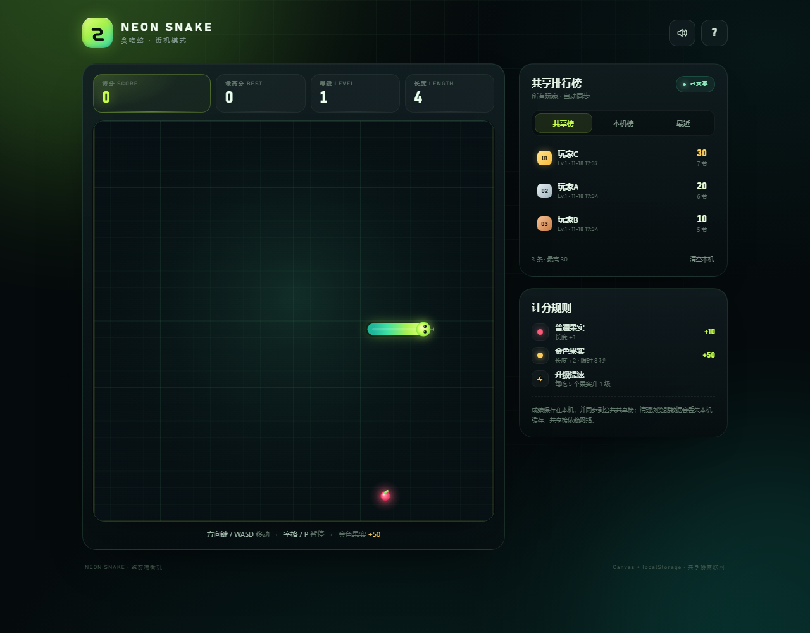

# 中国象棋 · Chinese Chess

一个纯前端的中国象棋游戏，支持 **联机对战、四档人机对战、五道残局关卡**。无需注册、无需安装依赖，打开页面即可下棋。



## 功能

### 联机对战

- **创建房间**：生成一个 6 位数字房间号，房主执红先行。
- **进入房间**：好友输入相同的 6 位房间号即可加入，加入者执黑。
- 房间界面显示双方昵称、红黑执子、连接状态和房间号。
- 走子、吃子、将军、将死、认输、再来一局实时同步。
- 访客棋盘自动翻转，黑方在下方；房主保持红方视角。
- 支持断线自动重连、房间满员提示、房间不存在提示和对手离开提示。
- 房间由房主维护：**房主关闭页面或离开房间后，该房间即结束**。

联机通过公共 MQTT 服务器 `broker.emqx.io` 的 WebSocket 服务完成，使用 `chinesechess/room/<房间号>` 主题和 QoS 1 消息。房间状态以 retained 消息保存在 Broker 上，因此刚加入的玩家也能立即拿到当前棋局。

> 这是公共测试 Broker，不需要账号，也不保证长期可用。房间号只用于匹配，不提供加密；请勿在房间中传输敏感信息。

### 人机对战

玩家执红先行，AI 执黑。四档棋力：

| 难度 | 搜索策略 | 大致思考时间 |
| --- | --- | --- |
| 简单 | 1 层搜索 + 较高随机性，会漏看吃子 | < 0.2 秒 |
| 一般 | 3 层 Alpha-Beta 搜索 | 约 0.6 秒 |
| 困难 | 4 层 Alpha-Beta 搜索 | 约 1.1 秒 |
| 地狱 | 迭代加深至 6 层，限时搜索 | 约 2 秒 |

AI 会评估子力、兵卒推进、马炮位置、士象防守和将帅安全，并识别将死/困毙。搜索在浏览器本地完成，不会上传棋局。

### 残局挑战

红方先行，目标是将死黑方。支持悔棋、提示和重玩，通关进度保存在浏览器本地。

| 关卡 | 名称 | 难度 | 局面特点 |
| --- | --- | --- | --- |
| 01 | 双车压境 | 入门 | 双车围攻黑将 |
| 02 | 马炮兵临 | 进阶 | 马、炮、兵配合 |
| 03 | 车炮夹击 | 进阶 | 车炮两翼呼应 |
| 04 | 三兵破阵 | 困难 | 三兵过河，车在后压阵 |
| 05 | 三子归边 | 大师 | 车马炮三子归边 |

## 运行

不需要构建，直接打开 `ChineseChess.html` 即可。推荐使用最新版 Chrome / Edge / Firefox。

如果浏览器对本地文件限制较多，也可以启动一个静态服务器：

```bash
cd chinese-chess
python -m http.server 8080
```

然后访问：

```text
http://localhost:8080/ChineseChess.html
```

联机模式需要能访问 `wss://broker.emqx.io:8084/mqtt`；本地人机和残局模式不依赖网络。

## 操作

- **点击棋子**：选中棋子，棋盘上会显示合法落点。
- **点击落点**：走子；点击对方棋子即吃子。
- **悔棋**：人机/残局模式可撤销自己与 AI 的上一回合；联机模式不可悔棋。
- **认输**：人机/残局直接结束；联机由房主同步结果。
- **提示**：残局模式显示当前关卡的思路提示。
- **音效**：右上角按钮开关，设置会保存在浏览器中。
- **帮助**：右上角 `?` 查看棋子走法。

## 规则实现

- 车：直线行走，不可越子。
- 马：走日字，蹩马腿时不能走。
- 相/象：走田字，塞象眼时不能走，不可过河。
- 仕/士：九宫内斜走一步。
- 帅/将：九宫内直走一步；双方帅将不可照面（白脸将）。
- 炮：移动不可越子；吃子必须隔一个炮架。
- 兵/卒：向前一步；过河后可左右走，不可后退。
- 每步棋必须保证己方帅/将不被将军；将被将军时只能应将。
- 一方无合法着法即判负：被将军为“将死”，未被将军为“困毙”。
- 当前版本未实现长将/重复局面自动判和；联机中可由玩家认输或关闭房间结束。

## 文件结构

```text
chinese-chess/
├── ChineseChess.html      页面入口
├── ChineseChess.css       水墨/木纹界面与响应式布局
├── ChineseChess.js        规则引擎、AI、Canvas 棋盘、联机逻辑
├── vendor/
│   └── mqtt.min.js        MQTT.js 浏览器构建（MIT）
├── preview.png            游戏预览
└── README.md              本说明
```

## 技术说明

- 棋盘使用 **Canvas** 绘制，包含木纹、楚河汉界、九宫斜线、兵炮位标记、上一步高亮、选中环、合法落点、将军提示和结果遮罩。
- 棋子走法、将军检测、合法着法生成和 AI 搜索全部使用原生 JavaScript，无象棋引擎依赖。
- 联机使用 **MQTT over WebSocket**：房主是棋局权威，访客发送走子请求，房主校验并发布新的 retained 状态；使用序号防止重复/过期状态覆盖新棋局。
- 音效由 Web Audio API 实时合成，无外部音频文件。
- 昵称、音效开关和残局进度保存在 `localStorage`。
- 页面适配桌面和手机宽度；手机端可完整浏览和点击操作，联机同样可用。

## 已知范围

- 单张棋盘，不含观战、聊天、计时、棋谱导入导出。
- 联机房间依附于房主页面；房主刷新或关闭后房间结束。
- 公共 MQTT Broker 的可用性和延迟不受本项目控制；若无法连接，请检查网络，本地模式仍可使用。
- “地狱”AI 在低性能设备上可能造成约 2 秒的主线程卡顿，这是浏览器内同步搜索的取舍。

## 第三方

- [MQTT.js](https://github.com/mqttjs/MQTT.js) — MIT License，已本地化到 `vendor/mqtt.min.js`。
- 公共联机服务器：[EMQX Public Broker](https://broker.emqx.io/)（WebSocket 端口 8084）。
- 字体使用系统自带的楷体/宋体/黑体回退，无外部字体请求。
