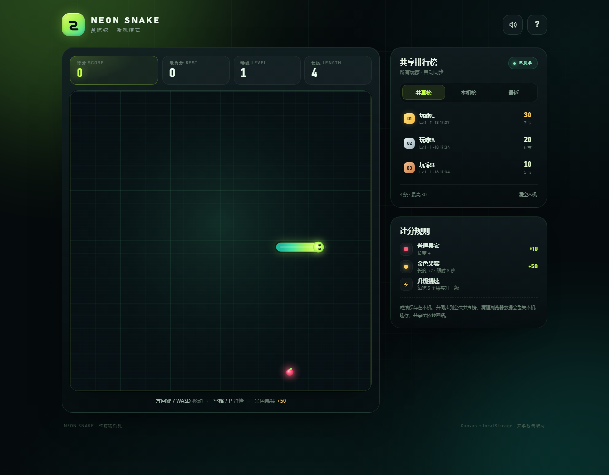

# 贪吃蛇 · NEON — 共享排行榜版

纯静态前端贪吃蛇：`Snake.html + Snake.css + Snake.js`，无需构建、无需自建后端。除了本机历史排行，还会通过公共消息服务同步一个**共享排行榜**，不同设备/玩家可以互相看到成绩。



> 说明：真正跨设备共享数据不可能只靠 `localStorage`。本项目没有自己的服务器，而是借助免登录的公共消息服务 `ntfy.sh` 作为共享存储；仍然只需要部署三个静态文件。

## 共享榜怎么工作

1. 游戏结束保存成绩时，先把成绩写入本机 `localStorage`，再向公共 topic 发布一条成绩事件。
2. 页面每 **12 秒**轮询一次 topic，把其他玩家的成绩合并进来，按分数排序展示前 10 名。
3. 有活跃玩家时，客户端最多每 **10 分钟**发布一次前 18 名快照，延长共享榜在公共缓存中的存活时间。
4. 网络失败时成绩进入**待同步队列**，页面刷新、恢复网络或点击右上角状态时会自动重试。
5. 共享榜数据也会缓存在本机，断网时可以看到上一次同步的结果。

状态标签含义：

| 状态 | 含义 |
| --- | --- |
| 连接中 | 正在首次连接共享榜 |
| 同步中 | 正在读取或上传成绩 |
| 已共享 | 已连上服务，数据已同步 |
| 待同步 | 本机有成绩还没上传，稍后自动重试 |
| 离线 | 当前无法访问共享服务，显示本机缓存 |

点击右上角状态标签可以立即刷新共享榜。

## 重要限制

- **需要联网**：游戏本身离线可玩，但共享榜需要访问 `ntfy.sh`。如果网络或服务不可用，共享榜会进入离线/待同步状态，本机成绩仍会保留。
- **公开榜单**：topic 没有登录和权限控制，任何知道链接的人都能读取，也能发送成绩；没有防作弊。昵称和分数会公开显示，请勿填写真实姓名、联系方式等敏感信息。
- **过期风险**：公共 `ntfy.sh` 免费缓存通常保留约 **12 小时**。有玩家继续访问时，客户端会用本机缓存重新发布快照续期；如果连续 12 小时以上没有任何玩家访问，共享榜可能清空，但每个玩家本机的历史记录仍然保留。
- **清空本机不会删除共享榜**：共享榜是公开的，本机按钮只清理当前浏览器的排行榜、历史记录、最高分和待同步队列。
- **生产环境建议**：如果要长期保存、防止篡改或做账号体系，请换成 Supabase / Firebase / 自建 API。远程读写集中在 `Snake.js` 的 `publishShared()`、`pullShared()`、`sharedBaseUrl()` 三个函数，替换起来比较直接。

## 文件

```text
snake-game/
├── Snake.html    页面入口
├── Snake.css     霓虹视觉与响应式布局
├── Snake.js      游戏逻辑、计分、共享榜同步
├── preview.png   预览图
└── README.md     本说明
```

## 运行

直接双击 `Snake.html` 即可游玩。Chrome 下已验证 `file://` 也能访问共享榜；如果某些浏览器禁止 `file://` 页面发起跨域请求，就用本地服务器：

```bash
cd snake-game
python -m http.server 8000
```

然后访问：

```text
http://localhost:8000/Snake.html
```

部署时把整个 `snake-game` 目录上传到任意静态托管即可（GitHub Pages、Nginx、Vercel、对象存储等）。

## 自定义共享榜

默认所有玩家使用同一个公共 topic：

```text
neon-snake-board-v1-7a3c9e5d
```

如果想和朋友单独开一个榜，只改地址栏参数即可：

```text
Snake.html?board=my-group-2026
```

把同一个链接发给朋友，大家就会进入同一个共享榜。`board` 只允许 3–64 位字母、数字、下划线或短横线：

```text
^[A-Za-z0-9_-]{3,64}$
```

也可以修改 `Snake.js` 顶部的 `SHARED.defaultTopic` 换成自己的默认 topic。注意：topic 仍然是公开的，`?board=` 只是分组，不是私密房间。

## 操作

| 操作 | 键盘 | 手机 |
| --- | --- | --- |
| 移动 | 方向键 / W A S D | 滑动棋盘 / 虚拟方向键 |
| 暂停 / 继续 | 空格 / P | 中间暂停按钮 |
| 开始 / 保存成绩 | Enter | 点击按钮 |
| 静音切换 | M / 右上角喇叭 | 右上角喇叭 |
| 刷新共享榜 | 点击右上角状态标签 | 点击右上角状态标签 |

## 计分与排行

- 普通果实：`+10` 分，长度 `+1`。
- 金色果实：`+50` 分，长度 `+2`，出现后 8 秒消失。
- 每吃 5 个果实升 1 级，移动速度逐级提升（150ms → 最快 68ms）。
- 共享榜按分数降序展示前 10 名，分数相同则先达成的排在前面。
- 本机排行保留最近 20 条，展示前 10 条；最近对局保留 50 条，展示最近 15 条。
- 保存时昵称最多 12 个字符，不填则记为「无名玩家」。
- 共享榜前 10 名之外的自己的成绩仍会保存，但列表只展示前 10。

## 本地存储键

| 键名 | 内容 |
| --- | --- |
| `neon-snake.scores.v1` | 本机排行榜 |
| `neon-snake.history.v1` | 本机最近对局 |
| `neon-snake.best.v1` | 本机最高分 |
| `neon-snake.name.v1` | 上次昵称 |
| `neon-snake.muted.v1` | 静音状态 |
| `neon-snake.shared.v1.<topic>` | 该 topic 的共享榜缓存 |
| `neon-snake.outbox.v1.<topic>` | 该 topic 的待同步成绩队列 |

`<topic>` 是当前共享榜的 topic 名。共享缓存放的是公开成绩，不包含密码等敏感信息。

## 共享同步的技术细节

- 发布：`POST https://ntfy.sh/<topic>`，消息体是一段 JSON（`text/plain`，避免额外预检请求）。
- 读取：`GET https://ntfy.sh/<topic>/json?poll=1&since=<时间>`，按行解析 NDJSON。
- 去重：以每条成绩的 `id` 为键合并，事件和快照重复不会重复计数。
- 校验：远端数据会检查 id、昵称长度、分数/等级/长度范围和日期，异常数据直接丢弃。
- 安全：昵称通过 `textContent` 渲染，不会把远端内容当 HTML 执行；但服务本身是公开可写的，无法防止别人伪造分数。
- 适配层：`publishShared()` / `pullShared()` / `sharedBaseUrl()` 与 UI、游戏逻辑解耦，方便替换成正式后端。

## 浏览器支持

支持现代 Chrome / Edge / Firefox / Safari，使用 Canvas 2D、Pointer Events、`ResizeObserver`、`fetch`、`async/await`、`localStorage`。共享榜依赖 `fetch` 和公共网络；不支持 Canvas 的旧浏览器会显示提示文本。
